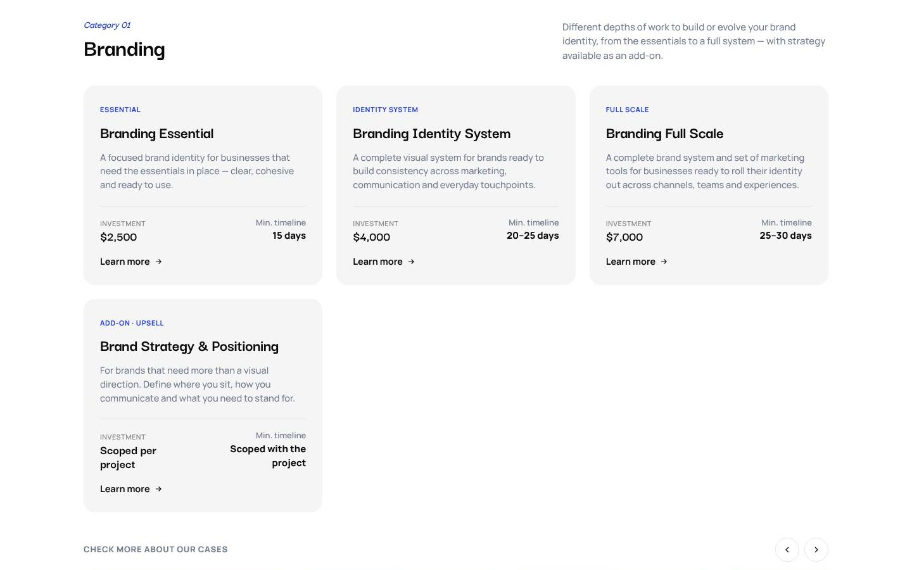
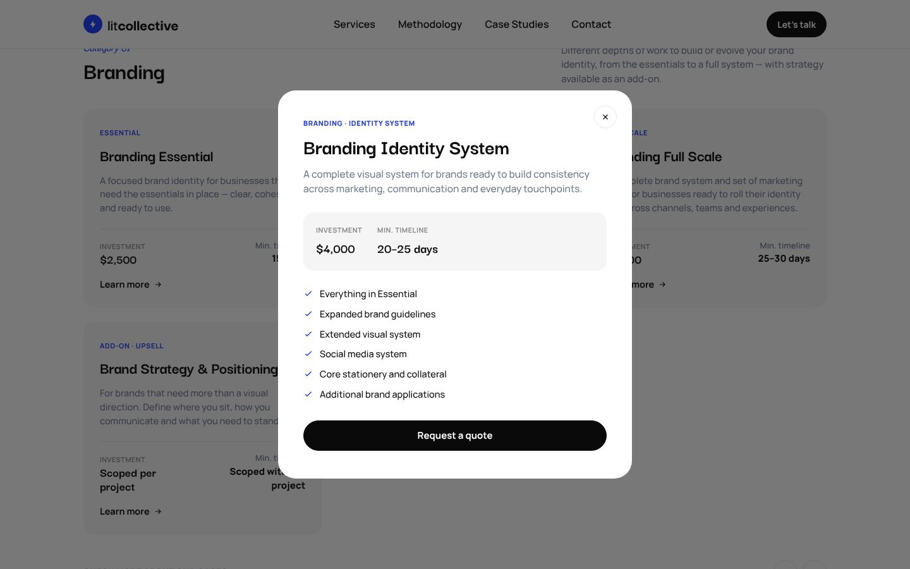
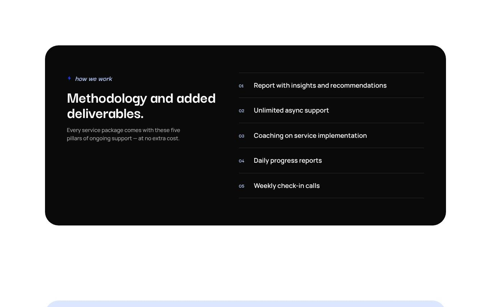

# Lit Collective — Services & Pricing

A pricing page for Lit Collective, a design studio for tech companies: every service with its investment, minimum timeline and deliverables, so prospects see clear scope from the first conversation.

**Live:** [lit-collective-prices.vercel.app](https://lit-collective-prices.vercel.app)


## What's inside

| Section | What it shows |
| --- | --- |
| **Hero** | Positioning, links to the services and a quote request, plus key facts (9 services, 7–20 day minimum turnaround, async support included). |
| **Branding** | Essential, Identity System and Full Scale packages, plus Brand Strategy & Positioning as an add-on. |
| **Case links** | A carousel to the studio website, Behance, Medium and the Filecoin Foundation deck. |
| **Digital presence** | Social media packages, landing page and full website. |
| **Design & product** | Illustration, UX/UI for digital products and motion design. |
| **Service details** | "Learn more" opens a modal with each service's investment, timeline and full list of deliverables. |
| **Methodology** | The five support pillars included with every package. |
| **Call to action** | Request a quote through a booking link. |

<table>
  <tr>
    <td></td>
    <td></td>
  </tr>
  <tr>
    <td></td>
    <td align="center"></td>
  </tr>
</table>

## Built with

- Plain **HTML** and **CSS**, with vanilla **JavaScript** for the mobile menu, carousel and service modal
- **Darker Grotesque** and **Manrope** from Google Fonts
- Deployed on **Vercel**

## Project structure

```
.
├── index.html    # the whole page: markup, styles, service data and scripts
├── favicon.svg   # Lit Collective bolt
├── docs/         # screenshots used in this README
└── README.md
```

Prices, timelines and deliverables live in the `services` object near the end of `index.html`.

## Run locally

No install needed. Open `index.html` in a browser, or serve the folder:

```bash
npx serve .
```

## Contact

- [LinkedIn](https://www.linkedin.com/in/fl%C3%A1vio-veloso-a29b02254/)
- [X @flaviovlso](https://x.com/flaviovlso)
- [github.com/flaviohcveloso](https://github.com/flaviohcveloso)

---

© 2026 Flávio Veloso. All rights reserved.
